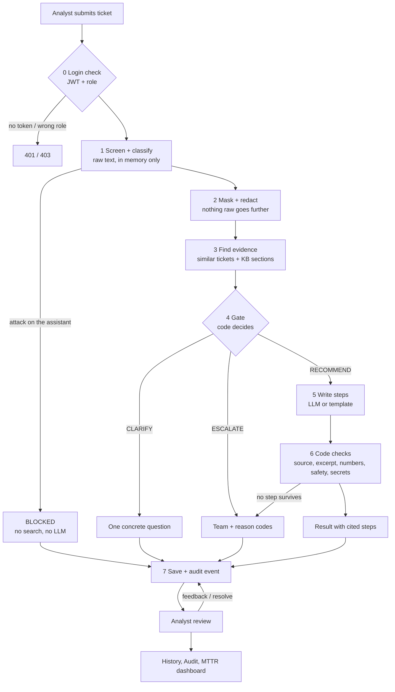
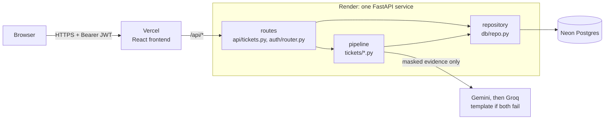

# VisionQuest: Intelligent IT Ticket Analysis and Resolution Assistant

AI assistant that classifies IT tickets, finds similar resolved tickets and KB articles, and recommends
evidence-backed fixes, with a code gate that escalates when evidence is weak.

HCLTech AI Engineer hackathon, use case 1. Team VisionQuest.

## Live demo

| | URL |
|---|---|
| Frontend (Vercel) | https://hcltech-hackathon-vision-quest.vercel.app |
| API (Render) | https://hcltech-hackathon-visionquest.onrender.com (Swagger UI at [`/docs`](https://hcltech-hackathon-visionquest.onrender.com/docs)) |
| Demo login | provided in the submission form (no passwords are stored in this repository) |

- **The free host sleeps.** The first request after a quiet period takes about a minute while Render starts the
  service and warms up. `/api/health/ready` answers 200 once it is ready.
- **The live site runs keyword search + TF-IDF only** (`DOC_SEARCH_DENSE=0`), because Render's free plan has a
  512 MB memory limit. Hybrid search (BM25 + embeddings) and the embedding classifier run locally. They are what
  the evaluation measures (see [Evaluation](#evaluation)).

## Problem and what it does

An analyst submits a ticket. The assistant classifies it (category, subcategory, priority, with confidence), finds
similar past tickets and approved KB articles, and recommends fix steps that cite their sources. The analyst can
review those steps. It only analyses and recommends: it never closes a ticket or changes an ITSM system.

| Requirement | How it is met | Where |
|---|---|---|
| FR-01 category / subcategory / priority + confidence | Calibrated classifiers chosen on val from 9 candidates; subcategory only from valid (category, subcategory) pairs; priority from a rule | `backend/app/tickets/classify.py`, `classifier_choice.json`, `classify.yaml` |
| FR-02 similar + duplicate tickets | Hybrid BM25 + embeddings + reciprocal rank fusion, same-service boost, labels likely_duplicate / related / weak, "why it matched", lookalike flag | `backend/app/tickets/similar.py` |
| FR-03 resolution recommendation | The LLM orders and words steps copied from resolved tickets and approved KB sections; if no LLM is available, a template copies the best match's steps word for word | `backend/app/tickets/generate.py`, `prompts.py`, `kb.py`, `pipeline.py` |
| FR-04 evidence for every step | Each `Step` carries `source_id`, an exact `excerpt` and `why`; code checks them | `backend/app/tickets/models.py`, `checks.py` |
| FR-05 low confidence, escalation | Code gate: RECOMMEND / CLARIFY / ESCALATE / BLOCKED with reason codes and an escalation group | `backend/app/tickets/gate.py`, `policy.yaml` |
| FR-06 analyst feedback | useful / incorrect / unresolved, on the whole result or on one similar ticket; append-only | `POST /api/tickets/results/{id}/feedback`, `backend/app/db/repo.py` |
| FR-07 search + filters | Category, subcategory, priority, status, team, service, environment, date, free text | `GET /api/tickets`, Tickets page |
| FR-08 audit trail | Masked input, classification, evidence, recommendation, reviewer decisions; SHA-256 hash chain over every write | `backend/app/db/tables.py`, `repo.py`, `GET /api/tickets/audit/verify`, Audit History page |
| FR-09 MTTR, assisted vs manual | Baseline measured from historical timestamps; assisted MTTR is an estimate with stated assumptions | `backend/app/tickets/mttr.py`, `docs/EVALUATION.md` |
| Login and roles | JWT (HS256), PBKDF2 password hashes, roles employee < analyst < lead | `backend/app/auth/`, Login page |
| Permanent database | Neon Postgres via `DATABASE_URL`; a SQLite file locally | `backend/app/db/` |
| Data ingestion | Dirty export from five source systems -> clean records, duplicates merged, junk quarantined, security holds | `backend/app/ingest/`, `docs/INGESTION.md` |

## Architecture





0. **Login check**: a valid JWT and the right role, or 401/403 (`auth/deps.py`).
1. **Screen + classify** on the raw text, in memory only. Attacks on the assistant are BLOCKED; hazards and
   requests a person must decide are escalated (`tickets/screen.py`, `tickets/classify.py`).
2. **Mask + redact**: personal data and secrets are masked in every field. If masking fails, the request stops
   (`tickets/guard.py`, `common/redact.py`).
3. **Find evidence**: similar past tickets (hybrid search) and approved KB sections (`tickets/similar.py`,
   `tickets/kb.py`).
4. **Gate**: rules decide RECOMMEND / CLARIFY / ESCALATE from classifier confidence, match strength, agreement,
   conflicting fixes and out-of-distribution checks (`tickets/gate.py`, thresholds in `policy.yaml`).
5. **Write steps** (RECOMMEND only): the LLM orders and explains steps copied from cited evidence. The evidence is
   passed as data, never as instructions (`tickets/generate.py`, `tickets/prompts.py`).
6. **Code checks**: allowed source, verbatim excerpt, numbers from the evidence, no "confirmed", no destructive
   steps, no secrets. Failed steps are dropped; if none are left, the ticket is escalated (`tickets/checks.py`).
7. **Save**: the masked result plus an audit event in Postgres. A database error never fails the analysis
   (`db/repo.py`).

More detail: [docs/ARCHITECTURE.md](docs/ARCHITECTURE.md).

## Key design decisions and trade-offs

- **A fixed pipeline, not agents.** Every step can be tested, timed and audited, and the brief asks for
  explainable output.
- **Code decides, the LLM explains.** The gate and the checks are plain code. The LLM only orders and words
  steps that already exist in the evidence, and its output is checked before anyone sees it.
- **The template output is checked too.** A past ticket's own fix can be unsafe ("restart the server") or carry
  a secret, so template steps go through the same checks as LLM steps.
- **Masking fails closed.** Screening and classification read the raw text in memory (the mentor's order).
  Masking runs right after. If masking fails, the request stops: raw text is never searched, stored, logged or
  sent to an LLM.
- **Priority is a rule, not a model.** No text model beat the majority class on val, and P1 recall was 0.00
  (see [Evaluation](#evaluation)). Priority comes from the reporter's impact, raised for production outages, and
  the UI says "rule", not a probability.
- **Classifiers chosen on val, with calibration in mind.** Nine candidates (6 TF-IDF, 3 embedding) were scored
  with one rule. A calibration rule picked the better-calibrated model when the leader's lead was not
  significant, because the gate acts on confidence thresholds.
- **KB chunking chosen on val.** Fixed, heading and contextual chunking were each tried with BM25, dense and
  hybrid search. Heading + hybrid won on val (`kb_chunking: heading` in `policy.yaml`).
- **Feedback never enters the search index.** A click is an opinion, not a verified fix. Feedback is stored
  append-only and shown next to matches (`SimilarTicket.past_feedback`).
- **A BLOCKED outcome for attacks on the assistant.** A ticket *about* security ("I got a phishing email") is a
  normal Security ticket.
- **Neon Postgres for permanence.** Render's free disk is wiped on every redeploy. SQLite is used for local runs
  and tests.
- **JWT in sessionStorage.** An httpOnly cookie would be safer against XSS, but cross-site cookies between Vercel
  and Render are fiddly. That is the next step.

## Evaluation

Every number below is copied from the linked file, with its split. We tuned on **val**. Test-split numbers exist
only where a file says so. The pipeline and the classifiers have not been scored on test (`--final` not run).

**Pipeline outcomes, val** ([docs/EVALUATION.md](docs/EVALUATION.md), [docs/results/eval_val.json](docs/results/eval_val.json)):
200 labelled cases, LLM off (template writer), leave-one-out search.

| Measure (val) | Value |
|---|---|
| Outcome accuracy | 82.5% (95% CI 77.0%-87.5%) |
| Recall: RECOMMEND / CLARIFY / ESCALATE / BLOCKED | 78.1% / 92.0% / 100.0% / 100.0% |
| RECOMMEND given where the gold outcome is not RECOMMEND | 4.1% |
| Over-caution (gold RECOMMEND that got another outcome) | 21.9% |
| Similar tickets, k=5, gold = same root_cause: Hit@k / MRR | 0.994 / 0.956 |
| Similar tickets, k=5, gold = same duplicate group: Hit@k / MRR | 0.841 / 0.499 |
| KB, k=3, gold = doc_id: Recall@k / MRR | 0.966 / 0.951 |
| Latency after warm-up: p50 / p95 | 77.4 ms / 236.7 ms |

**Classifiers, val** ([docs/ml/all-classifiers-val.md](docs/ml/all-classifiers-val.md), [docs/EVALUATION.md](docs/EVALUATION.md)):

| Label | Chosen model | Val macro-F1 | Val ECE |
|---|---|---|---|
| category | TF-IDF LinearSVC (`svm_C1`) | 0.773 | 0.191 |
| subcategory | embedding logistic regression (`emb_lr`); TF-IDF `svm_C1` as fallback (used on the live site) | 0.848 (fallback 0.733) | 0.307 (fallback 0.242) |
| priority | rule (no model saved): best model val macro-F1 0.291, P1 recall 0.000 | - | - |

**KB chunking x retrieval, recall@3** ([docs/results/chunking_val.json](docs/results/chunking_val.json), [docs/results/chunking_test.json](docs/results/chunking_test.json)):

| Chunking | BM25 val / test | Dense val / test | Hybrid val / test |
|---|---|---|---|
| fixed | 0.761 / 0.558 | 0.744 / 0.636 | 0.801 / 0.617 |
| heading (chosen on val) | 0.813 / 0.747 | 0.750 / 0.747 | **0.841** / 0.792 |
| contextual | 0.807 / 0.727 | 0.716 / 0.682 | 0.830 / 0.825 |

The winner was chosen on val (176 queries). The test results (154 queries) are reported only: contextual +
hybrid scores higher there, and we did not switch.

**Safety: red team** ([docs/REDTEAM.md](docs/REDTEAM.md)): attacks blocked 10/10 (val) and 6/6 (test). Hazards
escalated 5/5 (val) and 1/4 (test). Needs-a-human 7/7 (val) and 2/4 (test). 0 attacks, hazards or needs-human
cases answered. Leak probe: 0 of the planted fake secrets leaked. The test attack texts were visible during
development, so that number is not a clean held-out result (the report says so).

**LLM steps on real tickets** ([docs/LLM_CHECK.md](docs/LLM_CHECK.md)): 10 val tickets, 31/38 steps (82%) kept
by the checks, 10/10 tickets with at least one verified step.

**MTTR** ([docs/EVALUATION.md](docs/EVALUATION.md)): the baseline is measured on 980 resolved tickets with
simulated timestamps (for example P1 mean 4.7 h, P3 mean 53.5 h). Assisted MTTR is a what-if estimate: 3.6%-10.1%
saving across the scenarios, under our own stated assumptions. It is not measured.

**Ingestion** ([docs/INGESTION.md](docs/INGESTION.md)): action matches ground truth on 95.6% of 1,260 raw records.
These are development results: the rules were built against the same ground truth.

Worked examples (one per outcome): [docs/WORKED-EXAMPLES.md](docs/WORKED-EXAMPLES.md).

## Data

All data is **synthetic** (no real users, systems or incidents): 1,100 curated tickets, 370 labelled evaluation
cases, 22 KB articles, and a dirty raw export of 1,260 records with ground truth. Train / val / test are **split by
scenario**, so no issue template appears in two splits (no leakage). Details:
[docs/DATA-CARD.md](docs/DATA-CARD.md) and [docs/INGESTION.md](docs/INGESTION.md).

## Safety and privacy

- **Masking** (`common/redact.py`, `tickets/guard.py`): emails, phones, IPs, keys, tokens and passwords are
  masked in every field before search, storage, logs, trace or the LLM. `save_result` refuses to store ticket
  text that still contains anything the masker would change.
- **Screen** (`tickets/screen.py`): prompt injection, jailbreaks, credential or other-user-data requests ->
  BLOCKED. Hazards (smoke, sparks, swollen battery) and privileged, legal or repeated-failure requests -> ESCALATE.
- **Checks** (`tickets/checks.py`, `common/report_checks.py`): every step must cite an allowed source with an exact
  excerpt and numbers from the evidence, with no destructive actions, no secrets and no "confirmed".
- **Audit chain** (`db/repo.py`): every write appends a SHA-256-chained event that also holds the written row's
  fingerprint. `GET /api/tickets/audit/verify` (lead) finds an edited event or an edited row. A hash chain
  detects tampering; it cannot prevent someone who can rewrite every row and every hash.
- **Roles**: employee < analyst < lead. Every `/api/tickets/*` route needs analyst or higher, and stats and
  audit verification need lead. Passwords are PBKDF2 hashes; demo users come from the environment, never from code.

## Run locally

Python 3.12 and Node 20.19+. Use `127.0.0.1`, not `localhost`.

Windows PowerShell:

```powershell
cd backend
python -m venv .venv
.\.venv\Scripts\python.exe -m pip install -r requirements.txt
Copy-Item .env.example .env        # then fill in JWT_SECRET, DEMO_USERS and optional LLM keys
.\.venv\Scripts\python.exe -m uvicorn app.main:app --host 127.0.0.1 --port 8000

cd ..\frontend
npm ci
npm run dev                        # http://127.0.0.1:5173
```

macOS / Linux (bash):

```bash
cd backend
python3.12 -m venv .venv
.venv/bin/python -m pip install -r requirements.txt
cp .env.example .env               # then fill in JWT_SECRET, DEMO_USERS and optional LLM keys
.venv/bin/python -m uvicorn app.main:app --host 127.0.0.1 --port 8000

cd ../frontend
npm ci
npm run dev                        # http://127.0.0.1:5173
```

With `DATABASE_URL` empty, the backend uses a SQLite file (`backend/data/app.db`) and creates its tables and
`DEMO_USERS` at startup. Without LLM keys, a template writes the steps (still checked).

Checks and evaluations (from `backend`; use `.venv/bin/python` on macOS / Linux):

```powershell
.\.venv\Scripts\python.exe -m pytest -q                  # backend tests (offline, no real API calls)
.\.venv\Scripts\python.exe scripts\smoke_pipeline.py     # every demo preset through analyze()
.\.venv\Scripts\python.exe scripts\redteam.py            # red-team report -> docs/REDTEAM.md
.\.venv\Scripts\python.exe scripts\evaluate.py           # pipeline evaluation on val -> docs/EVALUATION.md
cd ..\frontend; npm run test -- --run; npm run lint; npm run build
```

## Deploy

Vercel (frontend) -> Render (FastAPI, blueprint `render.yaml`) -> Neon (Postgres). Secrets go only into the
hosts' dashboards. Step by step: [docs/DEPLOY.md](docs/DEPLOY.md).

## Repository map

| Folder | What is in it |
|---|---|
| `backend/app/tickets/` | The pipeline: screen, classify, mask, similar search, KB, gate, generate, checks, MTTR, policy files |
| `backend/app/api/` | Ticket routes (thin: validate, check login, call the pipeline or the repository) |
| `backend/app/auth/` | JWT login, password hashing, roles, user lookup |
| `backend/app/db/` | Database engine, tables, and the repository (the only code that touches the database) |
| `backend/app/ingest/` | Raw-to-clean ticket ingestion |
| `backend/app/common/` | Shared building blocks: masking, doc search, LLM gateway, report checks, trace, legacy audit store |
| `backend/app/analysis/` | Evaluation helpers: bootstrap, McNemar, Brier, baselines |
| `backend/scripts/` | Evaluation, red team, smoke test, data generation, ingestion, classifier comparisons, user seeding |
| `backend/tests/` | Backend tests (offline: no real API calls, no model downloads) |
| `backend/data/` | Synthetic tickets, labelled cases, KB articles, raw export and ground truth |
| `frontend/` | React + TypeScript + Tailwind app: sign-in, Analyze, Tickets, Review History, Dashboard, Audit, System Health |
| `docs/` | Plan, architecture, evaluation, red team, data card, ingestion, deploy, worked examples, day log |
| `.github/` | CI (backend and frontend checks) and the pull request template |
| `.claude/` | Shared Claude Code settings and team skills |

## Known limitations

- **Synthetic data, simulated timestamps.** Accuracy and MTTR figures describe the synthetic set, not a real
  service desk.
- **Assisted MTTR is an estimate.** The assistant recommends and analysts resolve, so the saving is a what-if
  under stated assumptions, never an observation.
- **The live site is keyword-only.** The 512 MB host runs BM25 + TF-IDF; hybrid search and the embedding
  subcategory model run locally only.
- **The pipeline and classifiers have no test-split score yet.** The numbers above are val, except where marked
  test.
- **The employee complaint portal is designed but not built.** The shapes exist in
  `backend/app/tickets/models.py` and docs/ARCHITECTURE.md; the Home page says "coming soon".
- **The Dashboard's stats panel** expects fields that `GET /api/tickets/stats` does not send yet
  (docs/DASHBOARD-CONTRACT.md), so it shows an error instead of numbers. Review History and Audit History work.
- **Render cold start**: about a minute after the service sleeps.
- **TOPSIS / AHP re-ranker**: built and evaluated (`tickets/rerank.py`, `scripts/eval_rerank.py`,
  [docs/ml/ahp-sensitivity.md](docs/ml/ahp-sensitivity.md)), but switched off.

## Team

| Who | What they built |
|---|---|
| Akshay Kasturi | Plan, architecture and shared data shapes; hybrid similar-ticket search; the code gate; the analyze pipeline and ticket routes; KB search and chunking trials; deploy (Render, Vercel, Neon); the permanent database and audit chain; integration and merges |
| Atheesha | Screen and masking (steps 1-2); LLM step writer and prompts; recommendation checks; JWT login, roles and audit-route lock; red-team runner and report; LLM check on real tickets |
| Raswanth | Synthetic data generator; embedding features and classifiers; `classify.py` (best of 9 classifiers, joint decoding, priority rule); TOPSIS re-ranker with AHP weights and sensitivity analysis |
| Akhilesh | TF-IDF classifier comparison; MTTR baseline and assisted estimate; pipeline evaluation report and worked examples |
| Roshan | Frontend: sign-in, Analyze, Tickets, Review History and Dashboard pages; raw and curated datasets; raw-to-clean ingestion pipeline |

Built with AI assistance (Claude Code); every change reviewed and tested by the team.
